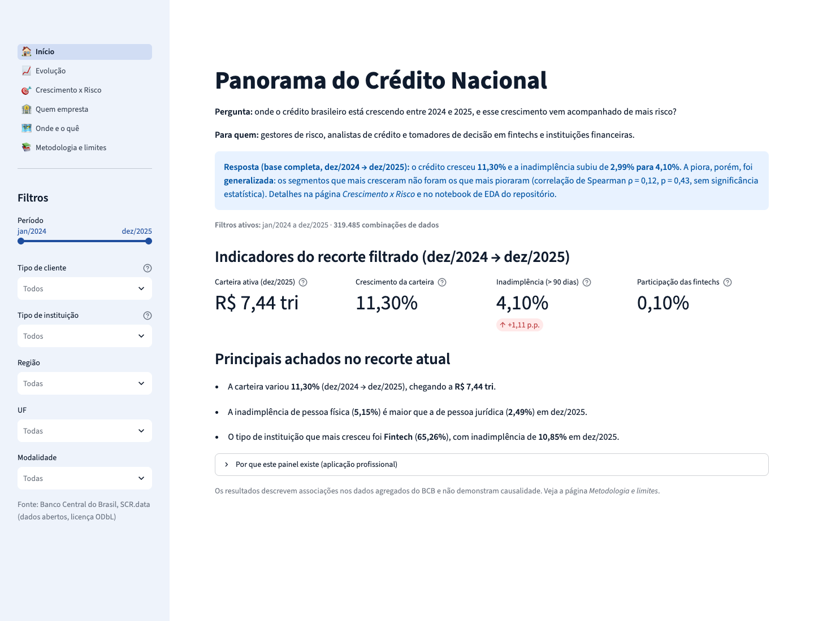
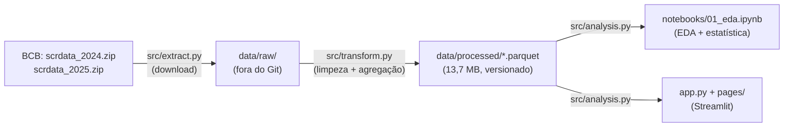
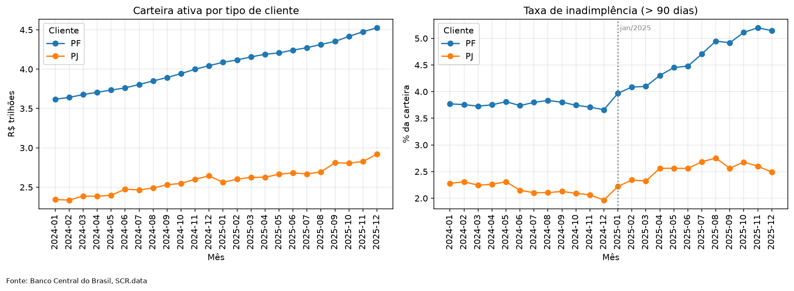
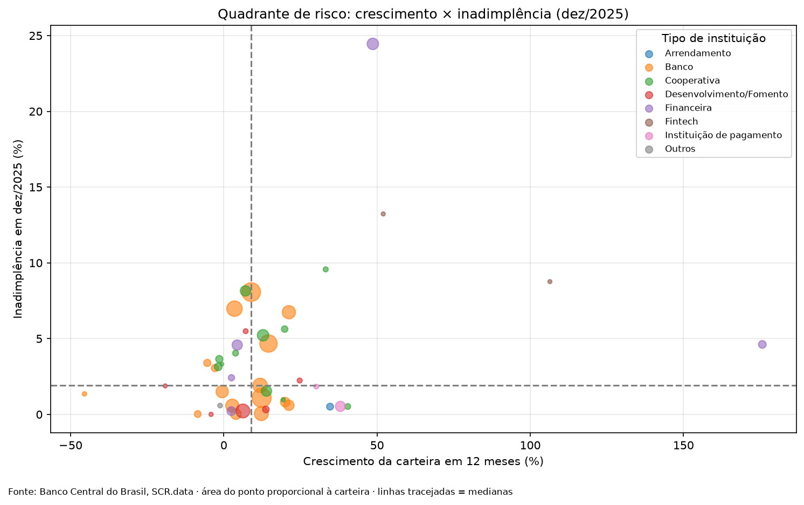
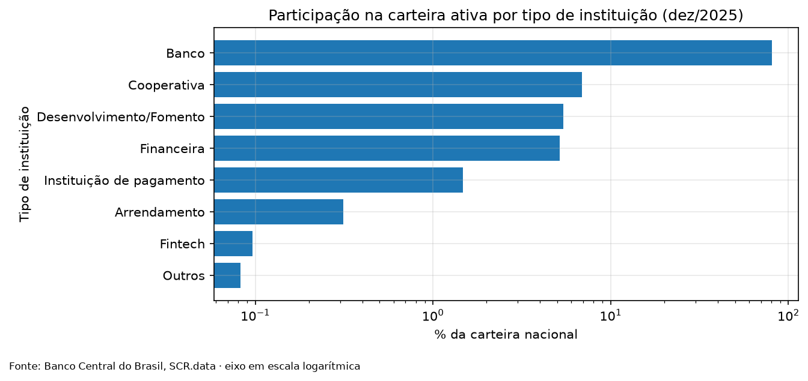
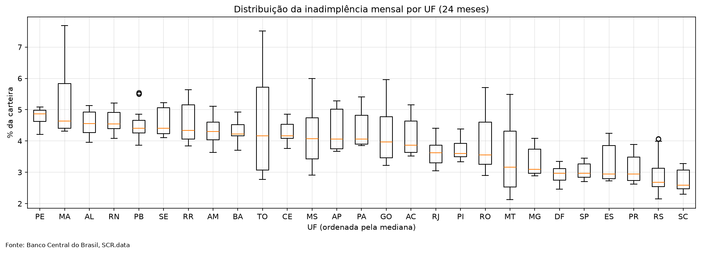
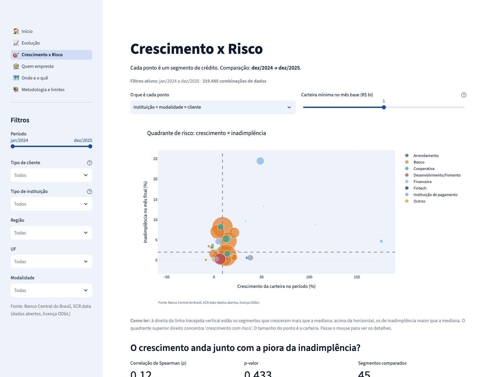

# Panorama do Crédito Nacional: crescimento e risco (SCR.data, 2024–2025)

> **App publicado:** _a preencher após o deploy_ · **Vídeo:** _a preencher_
>
> Projeto Final · Visualização de Dados e BI (Módulo 2) · SCTEC · SENAI/SC · LAB365 · 2026
> **Autor:** Anderson Diroza · **Professor:** Rodrigo Garcia Brunini



---

## 1. Título e resumo

**Panorama do Crédito Nacional** é uma solução de Business Intelligence construída em Python e Streamlit
sobre o **SCR.data**, a base pública do Banco Central do Brasil com as operações de crédito do país
(carteira de R$ 7,44 trilhões em dez/2025).

O projeto baixa os arquivos oficiais, trata e agrega 7,5 milhões de linhas (24 meses), calcula indicadores
e estatísticas e publica um painel interativo que responde: **onde o crédito brasileiro cresceu entre 2024
e 2025, e esse crescimento veio acompanhado de mais risco?**

## 2. Problema, objetivo e importância

**Pergunta orientadora:** onde o crédito brasileiro está crescendo entre 2024 e 2025, e esse crescimento
vem acompanhado de mais risco?

**Público:** gestores de risco, analistas de crédito e tomadores de decisão em fintechs e instituições
financeiras.

**Por que importa:**
- Crescer a carteira de crédito sem controlar a inadimplência destrói valor: a receita de juros de hoje
  vira perda amanhã.
- Para quem decide onde conceder crédito, saber em quais segmentos o crescimento é "saudável" e em quais
  ele vem com risco orienta a política de concessão, a precificação e o monitoramento.
- Os segmentos são combinações de tipo de instituição, modalidade, PF/PJ e UF.
- Para fintechs, que disputam espaço com bancos que detêm mais de 80% do mercado, o tema é estratégico.

**Objetivo:** construir um pipeline reproduzível (ETL, EDA, estatística e BI) que meça crescimento e risco
por segmento e teste se os dois andam juntos.

## 3. Escopo e resultados esperados

**Dentro do escopo:**
- carteira ativa, inadimplência e ativo problemático de **jan/2024 a dez/2025**
- recortes nacionais por PF/PJ, tipo de instituição, modalidade, porte, UF, região e crédito livre/direcionado

**Fora do escopo:**
- dados de pessoas ou de instituições específicas (o SCR.data é agregado)
- previsão e modelos preditivos
- anos anteriores a 2024
- explicações causais

**Entregas analíticas:**
- KPIs de carteira, crescimento, inadimplência e participação
- estatística descritiva por grupo
- correlação de Spearman entre crescimento e variação da inadimplência
- tendência linear com intervalo de confiança
- concentração de mercado (HHI)
- painel Streamlit com filtros

**Critérios de conclusão:**
- ETL reproduzível a partir das URLs oficiais, com o total validado contra o arquivo bruto
- EDA documentada com as análises acima
- app publicado e funcionando com os filtros
- README completo

## 4. Fonte e autorização dos dados

| Item | Valor |
|---|---|
| Fonte | SCR.data: Painel de Operações de Crédito (Sistema de Informações de Crédito) |
| Publicador | Banco Central do Brasil, Departamento de Monitoramento do Sistema Financeiro (BCB/Desig) |
| Página | https://dadosabertos.bcb.gov.br/dataset/scr_data |
| Arquivos usados | `https://www.bcb.gov.br/pda/desig/scrdata_2024.zip` e `scrdata_2025.zip` (12 CSVs mensais cada, ~356 MB compactados) |
| Metodologia | [Metodologia do SCR.data, versão 2](https://www.bcb.gov.br/pda/desig/metodologia_versao2.pdf) |
| Licença | Open Data Commons Open Database License (ODbL), conferida via API do portal em 19/10/2026 |
| Método de captura | download de arquivo público oficial (o portal não tem API de consulta filtrada) |
| Data de acesso | 19/10/2026 |
| Período | 2024-01 a 2025-12 (24 meses) |
| Atualização da fonte | mensal: o BCB publica no último dia útil do mês, com os dados disponíveis 30 dias após o fechamento do período |
| Campos usados | `data_base`, `uf`, `segmento`, `cliente`, `cnae_ocupacao`, `porte`, `modalidade`, `origem`, `numero_de_operacoes`, `carteira_a_vencer`, `vencido_de_15_ate_90_dias`, `carteira_vencida`, `carteira_ativa`, `carteira_inadimplencia`, `ativo_problematico` |

**Autorização, ética e LGPD:**
- Os dados são **públicos e agregados**: não há dados pessoais, dados sensíveis nem identificação de
  clientes ou de instituições.
- Não foi necessária autorização formal, porque a licença ODbL permite o uso com atribuição, feita neste
  README e no app.
- O próprio BCB protege a privacidade: combinações com poucas operações têm o número de operações
  suprimido (`-1`) para evitar reidentificação.
- O projeto respeita essa supressão: não tenta reverter o sigilo e apenas conta quantas combinações foram
  suprimidas.

O significado de cada coluna está em [docs/dicionario_dados.md](docs/dicionario_dados.md).

## 5. Pipeline e metodologia



### 5.1 Extração (`src/extract.py`)

Baixa os ZIPs anuais da URL oficial com `requests`:
- em streaming, para não carregar 180 MB na memória
- para um arquivo temporário `.part`, que só é renomeado ao terminar (um download interrompido nunca
  parece completo)
- com até 3 tentativas em caso de falha de rede
- validando se o conteúdo é mesmo um ZIP (o servidor pode devolver uma página de erro)
- sem baixar de novo um arquivo que já existe

### 5.2 Transformação e carga (`src/transform.py`)

Os 24 CSVs (cerca de 310 mil linhas cada) são lidos **um por vez**, para poupar memória. Cada regra abaixo
tem teste automatizado em `tests/test_transform.py`:

| # | Decisão | Justificativa |
|---|---|---|
| 1 | Valores `1.234,56` convertidos para número; valor inválido **interrompe** o ETL | O CSV usa o padrão brasileiro. Falhar é melhor do que gerar NaN em silêncio |
| 2 | `numero_de_operacoes = -1` vira 0 na soma e é contado em `combinacoes_suprimidas` | É sigilo do BCB, não erro. Os saldos continuam válidos |
| 3 | Espaços extras normalizados; categoria ausente vira "Não informado" | O CSV traz nomes com espaço duplo (ex.: "rurais  (ex-...") |
| 4 | Duplicadas exatas removidas (contagem registrada) | Proteção; nenhum mês tinha duplicadas |
| 5 | Livre/Direcionado derivado do campo oficial `origem` | É a classificação do próprio BCB, sem aproximação |
| 6 | Faixas de prazo, `submodalidade` e `indexador` descartados | Minimização: não respondem à pergunta |
| 7 | Carteira de dez/2025 validada contra o arquivo bruto (R$ 7,444 tri, tolerância de 1%) | Garante que a agregação não perdeu nem duplicou dados. **Resultado: desvio de 0,00%** |

A agregação reduz 7,5 milhões de linhas para 319 mil (`fato_credito`). As colunas de texto viram
`category` e tudo é gravado em **Parquet**, o que fez os dados passarem de 219 MB (CSV) para 13,6 MB.
Assim eles cabem no GitHub e o app abre rápido.

### 5.3 Indicadores (`src/analysis.py`)

Este módulo é a fonte única dos números: o notebook e o app chamam as mesmas funções.
- **Taxa de inadimplência** = saldo das operações com alguma parcela em atraso acima de 90 dias ÷ carteira
  ativa (definição do BCB)
- **Crescimento** = variação da carteira entre o mesmo mês de dois anos (dez/2024 → dez/2025), para não
  confundir crescimento com sazonalidade
- **Participação de mercado** e **HHI**

### 5.4 Estatística e por que cada método

| Análise | Método | Por que este método |
|---|---|---|
| Descritivas por grupo | média, mediana, desvio-padrão, quartis, mínimo e máximo da taxa mensal | Resumem centro e dispersão dos 24 meses de cada UF, modalidade e segmento |
| Crescimento × risco | **correlação de Spearman** (SciPy) entre o crescimento e a variação da inadimplência de 45 segmentos | Compara postos e não valores: é robusta a crescimentos extremos (+175%) e não supõe relação linear nem normalidade |
| Sensibilidade | Spearman repetido com cortes de carteira de R$ 0,1 bi a R$ 10 bi | Mostra que a conclusão não depende do corte escolhido |
| Tendência | regressão linear (`scipy.stats.linregress`) com IC de 95% (distribuição t) | Mede a variação média por mês e se ela é consistente. Calculada no período todo **e em cada ano**, porque a série muda de comportamento em jan/2025 |
| Concentração | HHI (Herfindahl-Hirschman) | Medida padrão de concentração usada por autoridades de concorrência (CADE) |

## 6. Bibliotecas e tecnologias

| Biblioteca | Versão | Função no projeto | Documentação |
|---|---|---|---|
| Python | 3.14 (local) / 3.12 (deploy) | Linguagem | https://docs.python.org/3/ |
| pandas | 3.0.6 | Leitura dos CSVs, limpeza, agregação, Parquet | https://pandas.pydata.org/docs/ |
| NumPy | 2.5.4 | Operações numéricas e tratamento de NaN | https://numpy.org/doc/ |
| SciPy | 1.18.1 | Spearman, regressão linear, distribuição t | https://docs.scipy.org/doc/scipy/ |
| PyArrow | 26.0.0 | Motor de leitura e escrita de Parquet | https://arrow.apache.org/docs/python/ |
| Requests | 2.34.2 | Download dos ZIPs do BCB | https://requests.readthedocs.io/ |
| Plotly | 7.1.0 | Gráficos interativos do app | https://plotly.com/python/ |
| Streamlit | 1.66.0 | Interface de BI, cache e navegação multipágina | https://docs.streamlit.io/ |
| Matplotlib | 3.11.2 | Gráficos estáticos do notebook (renderizam no GitHub) | https://matplotlib.org/stable/ |
| Jupyter / nbconvert / ipykernel | 1.1.1 / 7.17.2 / 7.4.0 | Notebook de EDA executado de ponta a ponta | https://docs.jupyter.org/ |
| pytest | 9.1.1 | 60 testes automatizados (regras de ETL, estatística e app) | https://docs.pytest.org/ |

`requirements.txt` traz só o que o app precisa no deploy; `requirements-dev.txt` acrescenta as
ferramentas de análise e de teste.

## 7. Resultados encontrados

Todos os números abaixo vêm de [notebooks/01_eda.ipynb](notebooks/01_eda.ipynb), executado com os dados
oficiais (comparação dez/2024 → dez/2025).

| Indicador | dez/2024 | dez/2025 | Variação |
|---|---|---|---|
| Carteira ativa | R$ 6,69 tri | R$ 7,44 tri | **+11,30%** |
| Inadimplência total | 2,99% | 4,10% | **+1,11 p.p.** |
| Inadimplência PF | 3,66% | 5,15% | +1,48 p.p. |
| Inadimplência PJ | 1,97% | 2,49% | +0,52 p.p. |
| Inadimplência crédito livre | 4,09% | 5,45% | +1,36 p.p. |
| Inadimplência crédito direcionado | 1,06% | 1,70% | +0,64 p.p. |

### 7.1 O risco subiu, e mudou de regime em jan/2025



*Como ler:* à esquerda, a carteira de PF e de PJ cresce de forma contínua. À direita, a inadimplência fica
estável em 2024 e sobe a partir de jan/2025 (linha pontilhada).

| Tendência da inadimplência total | Inclinação (p.p./mês) | IC 95% | R² |
|---|---|---|---|
| 2024 | -0,014 | -0,021 a -0,006 | 0,62 |
| 2025 | **+0,085** | +0,068 a +0,102 | 0,92 |

- Em 2024 a inadimplência caiu levemente.
- Em 2025 ela subiu de forma consistente: o intervalo de confiança não inclui zero.
- Pessoa física puxou a alta: +0,12 p.p./mês em 2025, com R² = 0,97.
- Na virada do ano houve um salto de **+0,31 p.p.** em um único mês, cinco vezes a maior alta mensal de 2024.

### 7.2 Mas quem cresceu mais não piorou mais



*Como ler:* cada ponto é um segmento (instituição × modalidade × PF/PJ). As linhas tracejadas são as
medianas, e o quadrante superior direito reúne os segmentos que cresceram e têm inadimplência acima da
mediana.

- **Correlação de Spearman = 0,12 (p = 0,43, n = 45):** não há associação estatisticamente significativa
  entre crescer mais e piorar mais.
- O resultado se mantém em todos os cortes de carteira testados, de R$ 0,1 bi a R$ 10 bi: ρ entre -0,03 e
  0,16, sempre com p ≥ 0,20.
- A piora foi **generalizada**: 7 de 8 tipos de instituição tiveram alta da inadimplência, inclusive os
  bancos (+0,93 p.p.).
- **Exceção que merece atenção:** o crédito pessoal (Empréstimos) de **financeiras para PF** cresceu
  48,63%, e a inadimplência foi de 19,30% para **24,45%**, a maior entre os segmentos grandes.

### 7.3 Quem empresta e onde



*Como ler:* o eixo está em escala logarítmica (cada marca é 10 vezes a anterior), porque os bancos são
muito maiores que os demais.

- Os bancos detêm **80,55%** da carteira. O HHI é de **6.594**, o que indica alta concentração (o limite
  é 2.500).
- As fintechs têm só **0,10%** do mercado, mas cresceram **65,26%**, a maior taxa entre os tipos de
  instituição. A inadimplência delas foi de 8,96% para 10,85%.



*Como ler:* cada caixa resume os 24 meses de uma UF; a linha central é a mediana.

- As medianas vão de **2,59% (SC)** a **4,87% (PE)**.
- As UFs do Norte e do Nordeste concentram as maiores medianas; Sul, Sudeste e DF, as menores.

## 8. Discussão e conclusão

**Resposta à pergunta:** o crédito cresceu 11,3% e o risco também subiu, mas o aumento do risco foi
**amplo** e não se concentrou nos segmentos que mais cresceram.

**Observações** (o que os dados mostram):
1. Crescimento e piora da inadimplência aconteceram ao mesmo tempo no agregado.
2. Entre segmentos, a correlação é fraca e não significativa (seção 7.2).
3. A série muda de regime em jan/2025 (seção 7.1).
4. Há bolsões de risco específicos, como o crédito pessoal de financeiras para PF.

**Hipóteses** (possíveis explicações, **não testadas** aqui):
- **H1 (mudança de regra em jan/2025):**
  - Para o **ativo problemático**, a metodologia do BCB registra uma mudança oficial de definição em
    jan/2025.
  - Para a **inadimplência**, a definição não mudou, mas o salto coincide com a entrada em vigor da
    Resolução CMN 4.966/2021 (novas regras contábeis de crédito).
  - Parte da alta pode ser mudança na forma de registro, e não só piora dos clientes.
- **H2 (fator comum):** como a piora atingiu quase todos os segmentos, independentemente do quanto cada um
  cresceu, um fator comum (por exemplo, o ciclo de juros) explicaria o movimento melhor do que a expansão
  de cada segmento.
- **H3 (efeito denominador):** crescer muito rápido pode *reduzir* a taxa no curto prazo, porque contratos
  novos ainda não tiveram tempo de atrasar. Exemplo: o crédito pessoal de fintechs para PF cresceu 106%, e
  a inadimplência caiu de 17,00% para 8,76%. Isso não prova que o risco caiu.

**Recomendações** (para o público do painel):
- Comparar períodos sob a **mesma regra contábil** (meses de 2025 entre si) antes de concluir que houve
  piora (H1).
- Em segmentos que crescem rápido, acompanhar a inadimplência **por safra de concessão** (H3).
- Priorizar o monitoramento do crédito pessoal para PF em financeiras (observação 4).

**O que NÃO pode ser concluído:**
- que crescer *causa* inadimplência, ou que *não* causa (correlação não é causalidade, e não controlamos
  juros, prazo nem perfil do tomador)
- qualquer afirmação sobre uma instituição específica (os dados são agregados)
- previsões para 2026 (24 meses é uma série curta, com quebra no meio)

## 9. Aplicação profissional

**Validação comercial:**
- Este projeto parte de um case comercial do autor sobre o mesmo dataset, publicado em outra tecnologia
  ([bcb-scr-data.andersondiroza.com.br](https://bcb-scr-data.andersondiroza.com.br)).
- Ao ser apresentado em funcionamento, o case gerou **contratos com clientes de menor porte** e **contatos
  de duas fintechs e de uma financeira de cartões**.
- Isso mostra demanda real por esse tipo de leitura.
- Esta versão em Python e Streamlit acrescenta o que um ambiente corporativo exige: processo documentado,
  testado e reproduzível.

**Como o pipeline seria usado numa empresa:**
- **Atualização:**
  - O BCB publica mensalmente, no último dia útil, com os dados disponíveis 30 dias após o fechamento.
  - Um agendador (GitHub Actions, Airflow ou cron) rodaria `extract` e `transform` todo mês.
  - O ETL já pula arquivos que existem e falha se faltar mês.
- **Qualidade:**
  - A validação do total nacional e a falha em caso de coluna ausente ou valor inválido já protegem contra
    mudanças de layout do BCB.
  - O relatório `qualidade_mensal` vira um monitor.
- **Segurança e privacidade:**
  - Os dados são públicos e não exigem credenciais.
  - Se forem cruzados com a carteira interna da empresa (o uso mais valioso, para comparar a carteira
    própria com o mercado), passam a envolver dados de clientes. Nesse caso entram as regras da LGPD:
    acesso restrito, anonimização e segredos em variáveis de ambiente, como já previsto no `.env.example`.
- **Governança:**
  - O dicionário de dados e as decisões de tratamento documentadas permitem auditoria.
  - A fonte única dos indicadores (`analysis.py`) evita números divergentes entre relatórios.
- **Manutenção:**
  - Os 60 testes automatizados detectam regressões.
  - O custo é baixo: os Parquets de 14 MB rodam no plano gratuito do Streamlit Community Cloud.

## 10. Aplicação Streamlit

**Link:** _a preencher após o deploy_



**Filtros na barra lateral** (valem para todas as páginas): período, tipo de cliente, tipo de instituição,
região, UF e modalidade. Cada página mostra os **filtros ativos** e a quantidade de combinações exibidas.

| Página | O que mostra |
|---|---|
| Início | A pergunta, a resposta, 4 KPIs do recorte filtrado e os principais achados em linguagem simples |
| Evolução | Carteira e inadimplência mês a mês (total, PF/PJ, instituição ou livre/direcionado), com a marcação de jan/2025 e a tabela de tendência por ano |
| Crescimento x Risco | O quadrante interativo (escolha o que é cada ponto e o corte mínimo), a correlação de Spearman explicada e a tabela dos segmentos |
| Quem empresta | Participação de mercado, HHI e crescimento e inadimplência por tipo de instituição |
| Onde e o quê | UFs (ranking e boxplot) e modalidades, com crédito livre x direcionado |
| Metodologia e limites | Fonte, licença, tratamento, definições, limites e qualidade dos arquivos brutos |

Todo gráfico tem título, eixos com unidade, legenda, fonte e uma nota de **"Como ler"**. Quando um filtro
não retorna dados, o app mostra uma mensagem explicativa em vez de um gráfico vazio. Se os Parquets
faltarem, ele explica como gerá-los.

## 11. Como executar

**Pré-requisitos:** Python 3.12 ou superior e Git.

```bash
git clone https://github.com/andersondiroza-dev/scr-credito-streamlit.git
cd scr-credito-streamlit
python3 -m venv .venv
source .venv/bin/activate          # no Windows: .venv\Scripts\activate
pip install -r requirements-dev.txt
```

**Só abrir o app** (os Parquets já estão no repositório):
```bash
streamlit run app.py
```

**Reproduzir todo o pipeline a partir da fonte oficial:**
```bash
python -m src.extract      # baixa ~356 MB do BCB para data/raw/ (ou copie os ZIPs para lá)
python -m src.transform    # gera data/processed/*.parquet e valida o total (cerca de 40 s)
pytest                     # roda os 60 testes
jupyter nbconvert --to notebook --execute --inplace notebooks/01_eda.ipynb   # reexecuta a EDA
```

**Variáveis de ambiente:** o projeto não usa senhas nem chaves. As variáveis de `.env.example`
(`SCR_DIR_RAW`, `SCR_DIR_PROCESSED`) são opcionais e servem só para mudar as pastas padrão. Nenhum
caminho absoluto está no código: tudo deriva de `src/config.py`.

## 12. Estrutura de pastas

```
scr-credito-streamlit/
├── app.py                    # entrada do Streamlit: carrega os dados, cria os filtros e a navegação
├── pages/                    # as 6 páginas do app (1_inicio.py ... 6_metodologia.py)
├── src/
│   ├── config.py             # caminhos relativos, URLs, colunas, validação e identificação do projeto
│   ├── extract.py            # E: download dos ZIPs oficiais
│   ├── transform.py          # T e L: limpeza, agregação, validação e Parquet
│   ├── analysis.py           # indicadores e estatísticas (fonte única dos números)
│   ├── graficos.py           # gráficos Plotly padronizados (título, eixos, fonte)
│   ├── interface.py          # componentes do app (carga com cache, filtros, avisos)
│   └── utils.py              # formatação brasileira (R$, %, p.p., meses)
├── notebooks/01_eda.ipynb    # EDA completa, executada, com conclusões
├── data/raw/                 # ZIPs do BCB (ignorado pelo Git)
├── data/processed/           # Parquets usados pelo app (versionados, 13,7 MB)
├── outputs/                  # gráficos e capturas usados neste README
├── docs/
│   ├── dicionario_dados.md   # dicionário de dados
│   ├── especificacao_projeto.md  # design aprovado antes do código
│   └── plano_implementacao.md    # plano das tarefas de implementação
├── tests/                    # 60 testes (pytest)
├── .streamlit/config.toml    # tema azul e branco
├── requirements.txt          # dependências do app (deploy)
├── requirements-dev.txt      # + notebook e testes
├── .env.example              # variáveis opcionais (sem segredos)
└── .gitignore                # ignora dados brutos, .venv, caches e .env
```

## 13. Limitações e melhorias futuras

**Limitações e possíveis vieses:**
- **Dados agregados:**
  - Não é possível analisar safras (data de concessão), juros nem perfil individual do tomador.
  - A inadimplência é o **saldo inteiro** das operações com alguma parcela em atraso acima de 90 dias,
    não só a parcela atrasada.
- **Sigilo:** cerca de 27% das combinações têm o número de operações suprimido. Os saldos continuam
  somados, mas a contagem de operações fica subestimada.
- **Cobertura:** só entram operações acima de R$ 200 (limite do SCR).
- **Quebra metodológica em jan/2025:**
  - O ativo problemático mudou de definição.
  - A inadimplência muda de regime no mesmo mês.
  - Comparações que atravessam a virada do ano devem ser lidas com cautela.
- **Série curta:** 24 meses, com uma quebra no meio.
- **Corte do Spearman:** o corte de R$ 1 bi é escolha do autor (mitigado pelo teste de sensibilidade).

**Melhorias futuras:**
- Estender a série para 2012–2025, para separar o ciclo econômico do efeito da Res. 4.966.
- Cruzar com a Selic e o desemprego pela API SGS do BCB, para testar a hipótese H2.
- Usar `fato_setor` numa página por setor econômico e ocupação.
- Atualização automática mensal com GitHub Actions.
- Um modelo de séries temporais para projetar a inadimplência, com o devido cuidado com a quebra.

## 14. Créditos e referências

- **Dados:** Banco Central do Brasil, [SCR.data](https://dadosabertos.bcb.gov.br/dataset/scr_data),
  licença ODbL.
- **Metodologia:** BCB,
  [Metodologia do SCR.data, versão 2](https://www.bcb.gov.br/pda/desig/metodologia_versao2.pdf) e
  [leiaute do documento 3040](https://www.bcb.gov.br/estabilidadefinanceira/scrdoc3040).
- **Regulação citada:** Resolução CMN nº 4.966/2021 (vigente desde 1º/01/2025).
- **Concentração (HHI):** CADE, *Guia para Análise de Atos de Concentração Horizontal* (2016), faixas
  de 1.500 e 2.500.
- **Bibliotecas:** pandas, NumPy, SciPy, PyArrow, Requests, Plotly, Streamlit, Matplotlib, Jupyter e
  pytest (documentação na seção 6).
- **Curso:** Visualização de Dados e BI, SCTEC · SENAI/SC · LAB365. Professor Rodrigo Garcia Brunini.
- **Uso de IA:** este projeto contou com o apoio do assistente de IA **Claude (Anthropic)** na
  estruturação do código, nos testes e na revisão da documentação. As decisões analíticas, a escolha do
  tema e a validação dos resultados são do autor.

## 15. Links de entrega

| Item | Link |
|---|---|
| Repositório pessoal (GitHub, privado) | _a preencher_ |
| App publicado (Streamlit Community Cloud) | _a preencher_ |
| Quadro de tarefas (Trello) | _a preencher_ |
| Repositório oficial da turma | _a preencher_ |
| Publicação no LinkedIn | _a preencher_ |
| Vídeo (Google Drive) | _a preencher_ |

## 16. Estratégia de versionamento

- **`main`:** versão estável, que recebe apenas versões prontas vindas de `develop`.
- **`develop`:** branch de integração, criada a partir de `main` no início do projeto.
- **Uma branch por etapa,** criada a partir de `develop` e juntada de volta com `git merge --no-ff`:
  `feature/etl`, `feature/eda`, `feature/app`, `feature/identificacao` e `docs/readme`.
  - O `--no-ff` preserva no histórico cada etapa como um bloco identificável, então é possível ver o que
    foi feito em cada fase.
- **Commits** pequenos, um por regra ou componente, com mensagens no imperativo em português (ex.:
  "adiciona regras de limpeza dos arquivos mensais do SCR.data").
- **Antes de cada commit:** testes passando (`pytest`).

```bash
git log --oneline --graph --all   # mostra o histórico com as etapas
```
