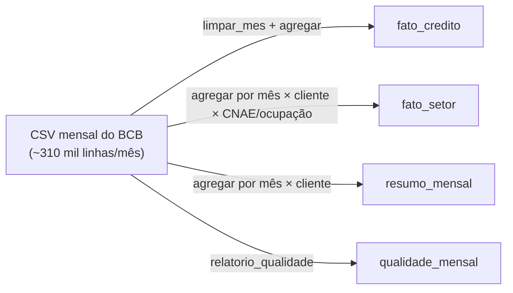

# Dicionário de dados

Este documento descreve as tabelas geradas por `src/transform.py` em `data/processed/`. As definições
das métricas seguem a [Metodologia do SCR.data, versão 2](https://www.bcb.gov.br/pda/desig/metodologia_versao2.pdf)
do Banco Central do Brasil.

- **Fonte:** SCR.data (BCB/Desig), arquivos `scrdata_2024.zip` e `scrdata_2025.zip`
- **Período:** jan/2024 a dez/2025 (24 meses)
- **Licença:** ODbL
- **Unidade monetária:** reais (R$), em valores nominais
- **Cobertura:** operações de crédito cursadas no país com valor acima de R$ 200 (limite de identificação do SCR)

## Como as tabelas se relacionam

As três tabelas de fatos vêm do mesmo arquivo limpo, só em níveis de agregação diferentes. Por isso,
para o mesmo mês, a soma de `carteira_ativa` é igual nas três (validado: R$ 7,444 tri em dez/2025).

## 1. `fato_credito.parquet`

319.485 linhas. É a tabela principal do app e do notebook. Cada linha é uma combinação
**mês × UF × cliente × tipo de instituição × modalidade × grupo de crédito × porte**.

| Coluna | Tipo | Descrição | Origem no CSV do BCB | Exemplo |
|---|---|---|---|---|
| `ano_mes` | texto | Mês de referência (AAAA-MM) | `data_base` ("2024-01-31" vira "2024-01") | 2024-01 |
| `uf` | categoria | Unidade da federação (CEP de residência da PF ou da sede da PJ) | `uf` | AC |
| `regiao` | categoria | Região geográfica (IBGE) | derivada de `uf` | Norte |
| `cliente` | categoria | Tipo de cliente: PF (pessoa física) ou PJ (pessoa jurídica) | `cliente` | PF |
| `segmento` | categoria | Tipo de instituição financeira, no agrupamento do BCB | `segmento` | Banco |
| `modalidade` | categoria | Modalidade da operação (Anexo 3 do leiaute do SCR), com espaços normalizados | `modalidade` | Empréstimos |
| `grupo_credito` | categoria | Livre ("Sem destinação específica") ou Direcionado ("Com destinação específica") | derivada de `origem` | Livre |
| `porte` | categoria | Faixa de renda (PF) ou porte da empresa (PJ) | `porte` | Até 1 salário mínimo |
| `numero_operacoes` | inteiro | Número de operações (o -1 de sigilo entra como 0) | `numero_de_operacoes` | 640 |
| `combinacoes_suprimidas` | inteiro | Quantas linhas do CSV original tinham `numero_de_operacoes = -1` (sigilo) | derivada | 5 |
| `carteira_a_vencer` | decimal (R$) | Soma dos créditos a vencer (todas as faixas de prazo) | `carteira_a_vencer` | 287,39 |
| `vencido_de_15_ate_90_dias` | decimal (R$) | Créditos vencidos de 15 a 90 dias | `vencido_de_15_ate_90_dias` | 10.233,82 |
| `carteira_vencida` | decimal (R$) | Vencido de 15 a 90 dias + vencido acima de 90 dias | `carteira_vencida` | 15.524,62 |
| `carteira_ativa` | decimal (R$) | Carteira a vencer + carteira vencida (saldo total) | `carteira_ativa` | 15.812,01 |
| `carteira_inadimplencia` | decimal (R$) | Saldo total (a vencer e vencido) das operações com **alguma parcela em atraso há mais de 90 dias** | `carteira_inadimplencia` | 5.290,80 |
| `ativo_problematico` | decimal (R$) | Operações classificadas como ativo problemático: atraso acima de 90 dias ou indícios de que não serão honradas (ex.: reestruturadas). **A partir de jan/2025**, só as operações que as próprias instituições classificam como ativo problemático | `ativo_problematico` | 13.764,46 |

## 2. `fato_setor.parquet`

720 linhas. Cada linha é **mês × cliente × CNAE/ocupação** (24 meses × 30 categorias).

| Coluna | Tipo | Descrição | Origem no CSV do BCB |
|---|---|---|---|
| `ano_mes` | texto | Mês de referência | `data_base` |
| `cliente` | categoria | PF ou PJ | `cliente` |
| `cnae_ocupacao` | categoria | Para PJ: seção (1º nível) da CNAE. Para PF: natureza da ocupação | `cnae_ocupacao` |
| `numero_operacoes` … `ativo_problematico` | | As mesmas métricas de `fato_credito` | |

## 3. `resumo_mensal.parquet`

48 linhas (24 meses × PF/PJ). São os totais nacionais por mês e tipo de cliente, usados na validação
do ETL. As colunas são `ano_mes`, `cliente` e as mesmas métricas de `fato_credito`.

## 4. `qualidade_mensal.parquet`

24 linhas, uma por arquivo mensal bruto. É o relatório de qualidade calculado **antes** da limpeza.

| Coluna | Tipo | Descrição |
|---|---|---|
| `ano_mes` | texto | Mês do arquivo |
| `linhas` | inteiro | Linhas do CSV original (entre 306 mil e 323 mil por mês) |
| `nulos` | inteiro | Total de células vazias (0 em todos os meses) |
| `duplicadas` | inteiro | Linhas duplicadas exatas (0 em todos os meses) |
| `combinacoes_suprimidas` | inteiro | Linhas com `numero_de_operacoes = -1`, cerca de 27% por mês |

## Indicadores calculados (`src/analysis.py`)

| Indicador | Fórmula | Unidade |
|---|---|---|
| Taxa de inadimplência | `carteira_inadimplencia` ÷ `carteira_ativa` × 100 | % |
| Taxa de ativo problemático | `ativo_problematico` ÷ `carteira_ativa` × 100 | % |
| Crescimento da carteira | (`carteira_ativa` no mês final ÷ `carteira_ativa` no mês base − 1) × 100 | % |
| Variação da inadimplência | taxa no mês final − taxa no mês base | p.p. |
| Participação de mercado | `carteira_ativa` do grupo ÷ `carteira_ativa` total × 100 | % |
| HHI | soma das participações (em %) ao quadrado | 0 a 10.000 |

## Valores possíveis das categorias

- **segmento (8):** Arrendamento, Banco, Cooperativa, Desenvolvimento/Fomento, Financeira, Fintech, Instituição de pagamento, Outros.
  - **Fintech** reúne as Sociedades de Crédito Direto e as Sociedades de Empréstimo entre Pessoas.
  - **Financeira** são as Sociedades de Crédito, Financiamento e Investimento.
  - A tabela completa está na metodologia do BCB, item 3.c.
- **cliente (2):** PF, PJ.
- **porte (13):**
  - PF: Sem rendimento, Até 1 salário mínimo, Mais de 1 a 2, Mais de 2 a 3, Mais de 3 a 5, Mais de 5 a 10, Mais de 10 a 20, Acima de 20 salários mínimos.
  - PJ: Micro, Pequeno, Médio, Grande.
  - Ambos: Indisponível.
- **modalidade (13):** Adiantamentos a depositantes, Direitos creditórios descontados, Empréstimos, Financiamentos, Financiamentos com interveniência, Financiamentos de infraestrutura e desenvolvimento, Financiamentos de títulos e valores mobiliários, Financiamentos imobiliários, Financiamentos rurais (ex-financiamentos rurais e agroindustriais), Financiamentos à exportação, Financiamentos à importação, Operações de arrendamento, Outros créditos.
- **grupo_credito (2):** Livre, Direcionado.
- **regiao (5):** Norte, Nordeste, Centro-Oeste, Sudeste, Sul.
- **cnae_ocupacao (30):**
  - PJ: 21 seções da CNAE mais "Não informados".
  - PF: Aposentado/pensionista, Autônomo, Empregado de empresa privada, Empregado de entidades sem fins lucrativos, Empresário, MEI, Servidor ou empregado público, Outros.

## Colunas do CSV original que não foram mantidas

Pelo princípio de minimização (usar só o necessário para a pergunta), estas colunas foram descartadas:
- `submodalidade` e `indexador`
- as faixas de prazo a vencer, de `a_vencer_ate_90_dias` a `a_vencer_acima_de_5400_dias`, porque só o total delas (`carteira_a_vencer`) é usado
- `vencido_acima_de_90_dias`, que já está contido em `carteira_vencida`
